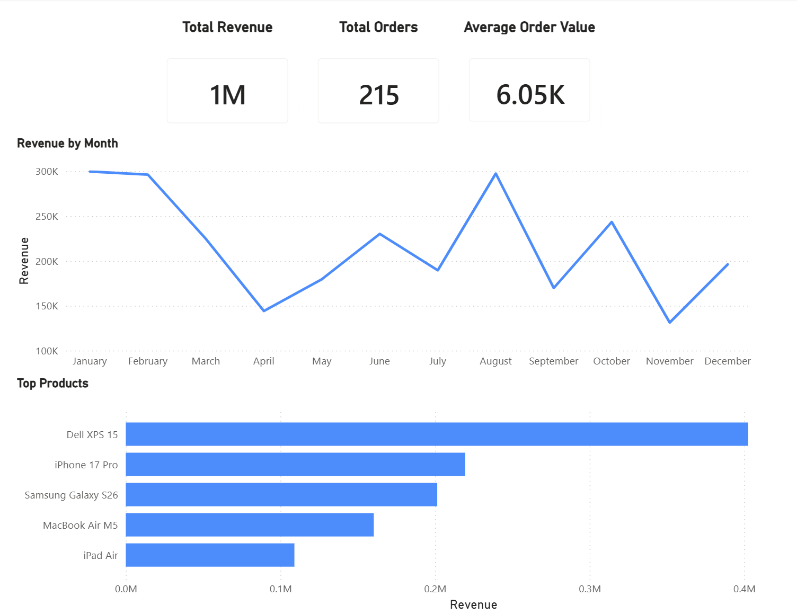

# Internet Shop Analytics

A training project demonstrating the full analytics workflow: data generation, SQL analysis, and Power BI visualization.

## Technologies

- Python
- SQLite
- SQL
- Power BI
- Git

## Dashboard



## Features

- Total Revenue KPI
- Total Orders KPI
- Average Order Value KPI
- Revenue by Month
- Top 5 Products by Revenue

## Project Structure

```
database/
python/
sql/
data/
powerbi/
images/
```